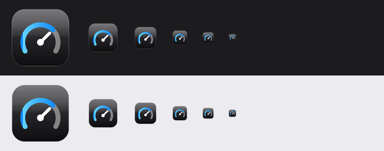
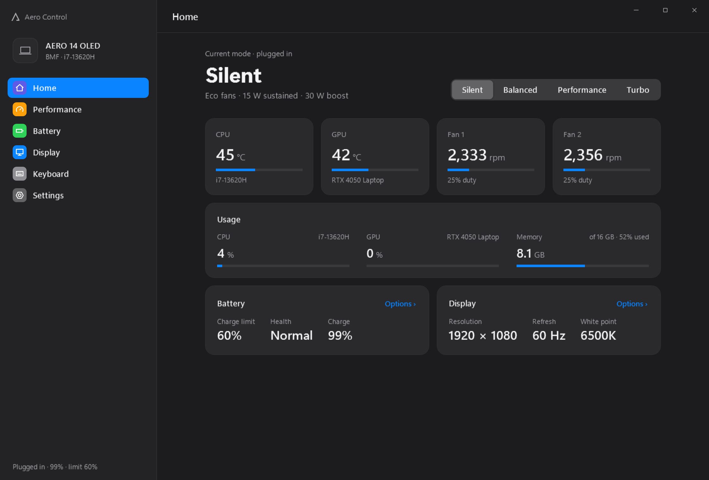
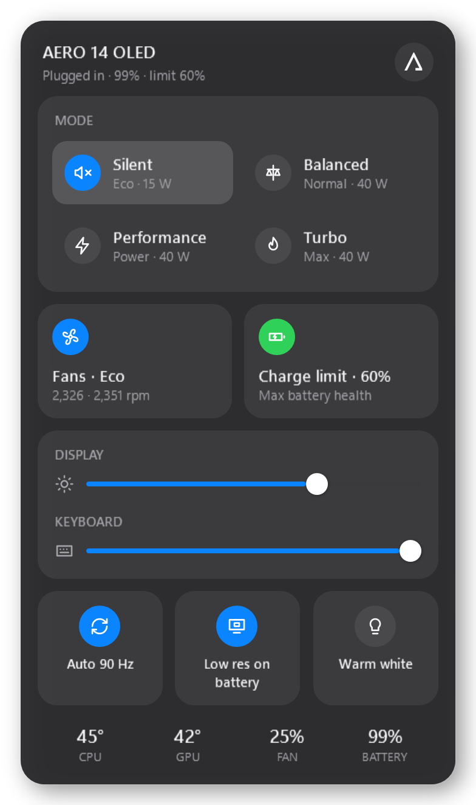
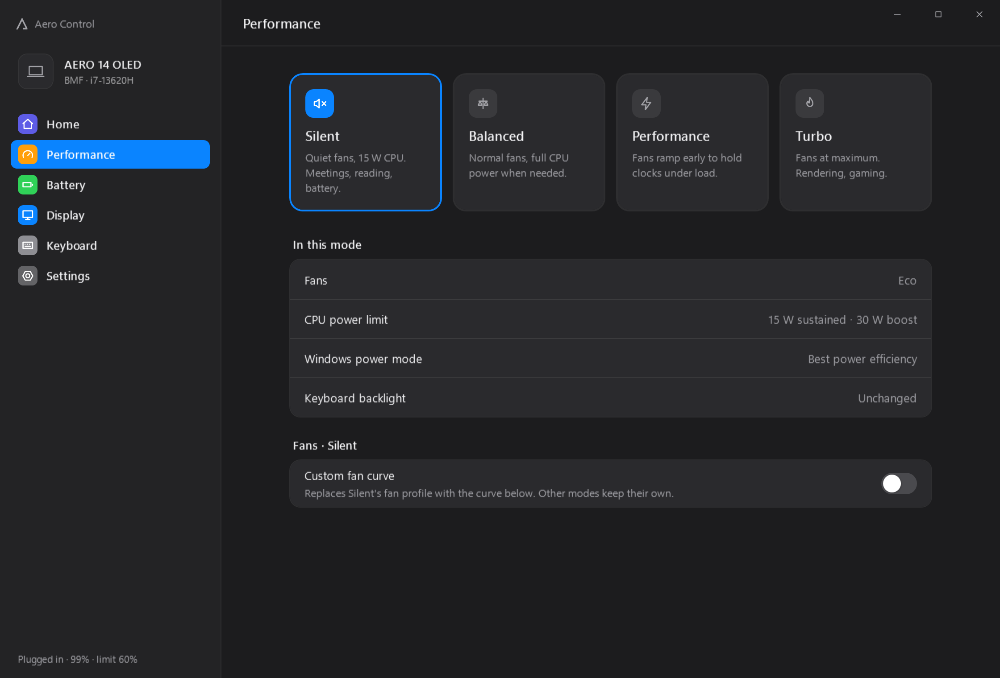
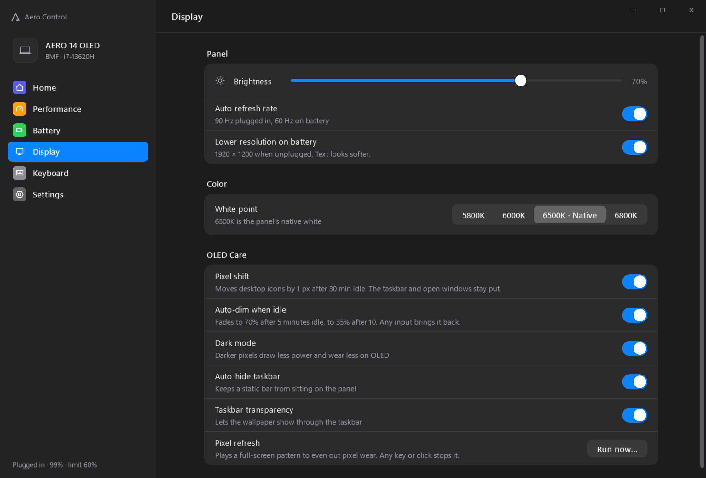
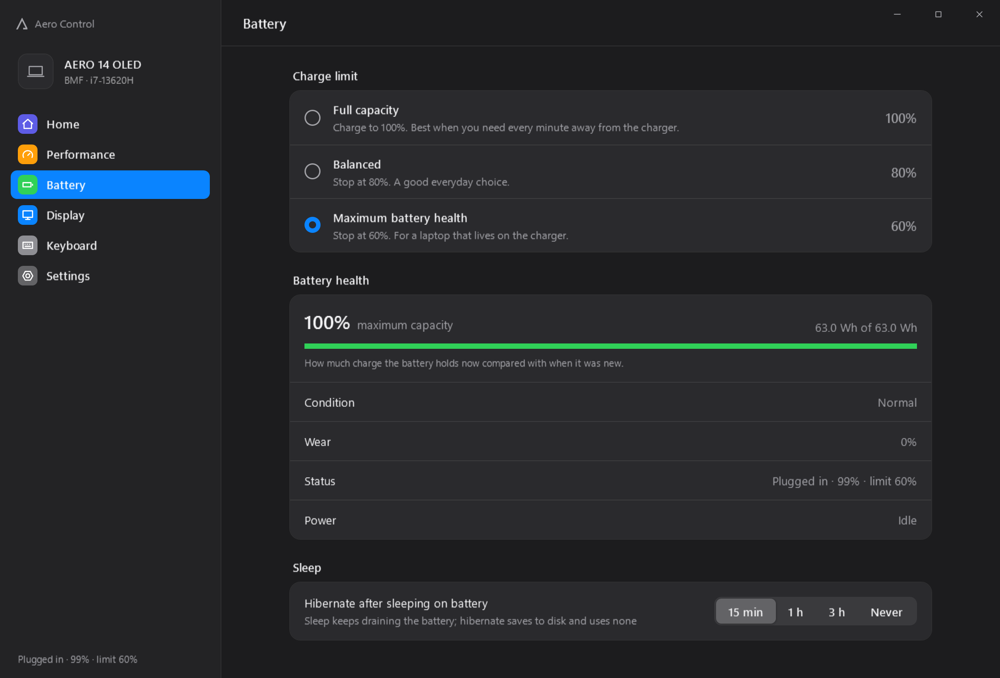
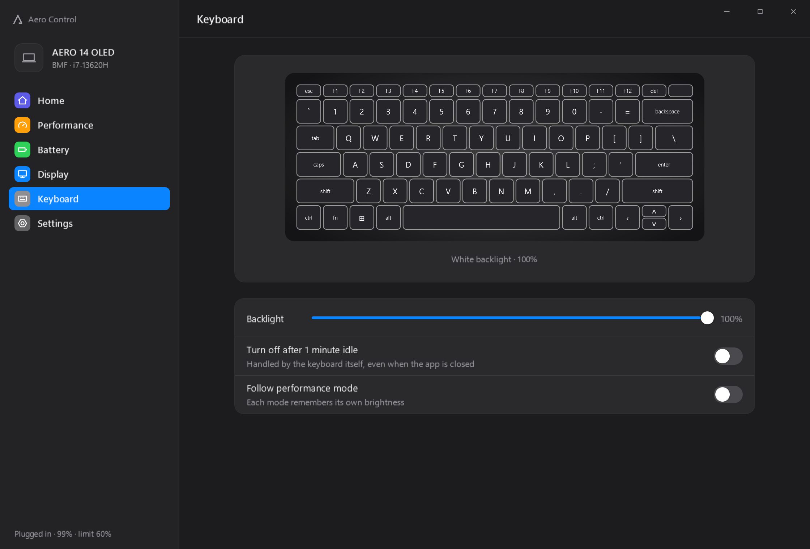
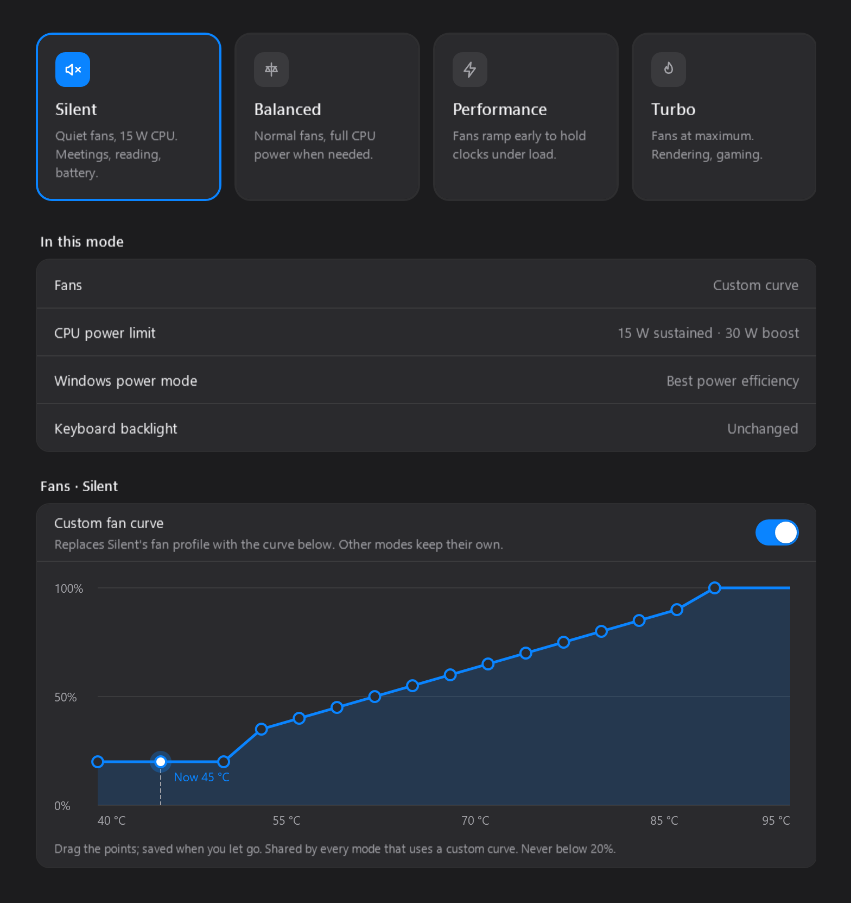

# Aero Control

A macOS-styled replacement for GIGABYTE Control Center (GCC), built for the **GIGABYTE AERO 14 OLED (BMF)**.
WPF on .NET Framework 4.8, runs elevated, lives in the tray.

<p align="center"></p>

<p align="center"></p>

## Features

- **Home**: CPU/GPU temperatures (amber/red when hot), fan speeds, and CPU/GPU/memory usage from Windows' own counters (reading them never wakes the RTX 4050)
- **Power modes**: Silent / Balanced / Performance / Turbo: fans, CPU power limits, Windows power mode and keyboard backlight per mode, separate modes on AC and battery with automatic switching
- **Display**: 90/60 Hz switching, optional lower resolution on battery, brightness, white point
- **Battery**: charge limit (100 / 80 / 60 %), maximum capacity and wear, charge/discharge watts, time left or time to the limit, and how long the laptop sleeps on battery before it hibernates
- **OLED care**: dark mode, taskbar auto-hide/transparency, pixel refresh, auto-dim when idle, pixel shift
- **Keyboard**: white backlight level, per-mode levels, auto-off
- **Fn keys** with macOS-style popups in the top-right corner: mode cycle (Fn+Esc), brightness, keyboard light, touchpad, microphone, and volume (replaces the Windows volume flyout)
- **Custom fan curve** per mode, with a live dot for the current temperature (never below 20%)
- **Tray**: a Control Center-style popover, and a hover text with mode, fan speed, temperatures and battery

## Screenshots

| Tray popover | Fn-key popup |
|---|---|
|  |  |

| Performance | Display |
|---|---|
|  |  |

| Battery | Keyboard |
|---|---|
|  |  |

| Custom fan curve |
|---|
|  |

## Requirements

- GIGABYTE AERO 14 OLED BMF (other models are untested and may behave differently)
- Windows 10/11, .NET Framework 4.8
- **GIGABYTE Control Center installed** (it does not need to run): Aero Control loads GCC's own `CPUOC.dll` for CPU power limits. No GIGABYTE files are included in this repository.

## Build and install

From an elevated PowerShell:

```powershell
powershell -NoProfile -ExecutionPolicy Bypass -File tools\install.ps1 -Startup
```

This builds a Release, installs it to `C:\Program Files\AeroControl`, registers a logon task (`-Startup`) and starts it in the tray.
To stop GCC from starting as well: `schtasks /Change /TN GCC /DISABLE` (undo with `/ENABLE`).

Settings and a log of every hardware write are in `%LOCALAPPDATA%\AeroControl`.

### Diagnostics

- `AeroControl.exe --probe <file>`: read-only survey of firmware, keyboard and display
- `AeroControl.exe --shot <dir> [--scale 2]`: render every page (dark and light) to PNG, read-only
- `AeroControl.exe --sweep [dir]` (with the normal app closed): really switches each mode, keyboard level and charge limit, screenshots each step, logs what the hardware reports, then restores everything. `python tools\sweep-sheet.py <dir>` merges a sweep into one image

## Disclaimer

Unofficial and not affiliated with GIGABYTE. It talks directly to the laptop's firmware (WMI), the CPU's power-limit registers and the keyboard controller. Use at your own risk.
